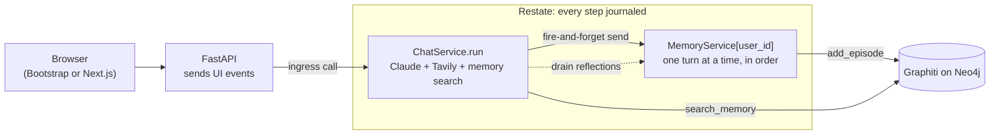

# chat-app-pydantic-ai

**A personal AI assistant that remembers what is true about me now, and never turns a bad day into who I am.**

FastAPI · [pydantic-ai](https://ai.pydantic.dev) · Claude · [Restate](https://restate.dev) for durable execution · [Graphiti](https://github.com/getzep/graphiti) on Neo4j for temporal memory.
Status: personal project, single user, actively developed.

## Why it exists

I built this for myself. I have AuDHD, and most assistants tire me out in one of two ways: I have to re-explain my context every time, or the ones that do remember treat a passing state as a fact about me.

| Requirement | How it's met |
|---|---|
| A mood is not an identity | Each statement is stored as a transient state (`Feels`, `EnergyLevel`) or a durable fact (`WorksOn`, `Prefers`, `HoldsOpinion`, `HasHabit`). The agent's memory search returns durable facts only. |
| Remember what's true *now* | Graphiti records when each fact became true and when it stopped being true. A contradicting fact invalidates the old one, and memory search returns only facts that are still valid. |
| Notice change, gently | Invalidated facts become reflections the agent can raise, without judgement, on the next turn. |
| No re-explaining | Every substantive turn is written to the memory graph in the background. |

## How it works



| Box | Code |
|---|---|
| FastAPI, both chat endpoints | [`chat_app.py`](chat_app.py) |
| `ChatService`, `MemoryService` | [`restate_service.py`](restate_service.py) |
| Graphiti client, memory types, ingestion, search | [`memory.py`](memory.py) |
| Next.js CopilotKit UI (optional) | [`frontend/`](frontend/) |

UI events are sent from FastAPI, outside the journal, so a replay never duplicates text on screen.

## Why durable execution

Memory is only as trustworthy as the path that writes it. Graphiti decides what is still true by comparing each new episode with the graph earlier episodes built, so turns must be ingested **one at a time, in order, with none lost or duplicated**. Graphiti leaves that to the caller: ["serial ingestion does not put overlapping calls in order"](https://help.getzep.com/graphiti/core-concepts/concurrent-ingestion), and ["a host application can supply its own orchestration"](https://github.com/getzep/graphiti/blob/main/spec/concurrent-group-ingestion.md).

- **Choice.** Restate is that orchestration. Each turn is sent to a [Virtual Object](https://docs.restate.dev/foundations/services) keyed by user ID. Restate runs one handler per key at a time, in arrival order, and persists the queue. Ingestion is ordered, survives restarts, and doesn't hold up its own reply. The next turn does wait for it, because reading the pending reflections queues behind the ingest on the same key. That wait is what makes the reflections ready in time. An ingest costs about 7 LLM calls, and once its result is journaled it is never recomputed.
- **Alternatives.** FastAPI `BackgroundTasks` (which Graphiti's docstring suggests) is simpler, but loses queued turns on restart and has no per-user ordering. Celery, or an outbox table plus a worker, would work, at the cost of a broker and hand-written ordering and idempotency.
- **Cost.** One more server to run and register with. Handler code must be deterministic. And because the agent runs inside a journaled handler, the UI receives the finished reply rather than a token stream.
- **What would change my mind.** Graphiti's new opt-in concurrent ingestion orders commits and can keep its state in a durable store. If that matures on Neo4j, a plain worker might be enough.

**What the runtime doesn't give you.** The journal makes a step's *recorded result* exactly-once, not its side effects. Writing this README surfaced two bugs, fixed in [743f03b](https://github.com/devops-adeel/chat-app-pydantic-ai/commit/743f03b):

1. A wall-clock timestamp was passed into a Restate call. On replay it would differ from the journal and stall the invocation. It now comes from `ctx.time()`.
2. A crash after the Neo4j write, but before the step was journaled, re-runs the step. Graphiti never deduplicates episodes, so the retry wrote a second copy. The episode ID now comes from `ctx.uuid()`, which is stable across retries, and the episode node is created only once.

The guarantee is now: no duplicate episodes. Facts are re-extracted on retry and converge through Graphiti's own deduplication (best-effort). Two traces of the interrupted attempt remain: a reflection it produced can be lost, and its episode→entity mention links are created again (3 → 6 in a measured run), which inflates mention-based ranking.

## Evidence

Live runs on 2026-11-18 at [24d9d7d](https://github.com/devops-adeel/chat-app-pydantic-ai/commit/24d9d7d): Claude Sonnet 4.6 for extraction, `text-embedding-3-small` for embeddings, `gpt-4o-mini` for reranking. Extraction is an LLM call, so each scenario ran 5 times. A scenario only counts as passing if it passed every time.

| Check | Result |
|---|---|
| **Stale → current.** "My main focus is my PhD thesis" (3 weeks ago), then "shelved the thesis, started a new job". Search returns the job, and none of the facts the graph marks invalid. | 5/5 |
| **A mood is not an identity.** "I feel completely useless… total autistic burnout. My long-term goal is still my novel." The mood is stored as `Feels` and `EnergyLevel`, the goal as `WorksOn`, and no durable fact carries the mood. | 5/5 |
| **Retry after a crash.** The same turn ingested twice under one episode ID: still one episode, and fact edges stay at 2. | 5/5 |
| **Restate retries with the same ID.** [`tests/test_restate_retry.py`](tests/test_restate_retry.py) injects a crash inside the step against a real Restate 1.7.0, and the retry reuses the episode. Swapping `ctx.uuid()` for `uuid4()` makes it fail. | passes |

The first version of this eval passed while the stale "thesis" fact came back as current, because it only checked that "job" appeared. Search never filtered out invalidated facts. The check now compares results against the graph's own invalidation marks, and fails with the fix ([24d9d7d](https://github.com/devops-adeel/chat-app-pydantic-ai/commit/24d9d7d)) switched off.

<details><summary>Output of one run, and how to reproduce</summary>

```text
=== Scenario 1: temporal contradiction (thesis → job) ===
  reflections (nudge): ["changed: Alex has shelved (paused) work on Alex's thesis and it is no longer Alex's main focus.", "changed: Alex's main focus is finishing their PhD thesis."]
Durable facts for 'What is my main focus at the moment?':
  - Alex just started a new job this week and it has become Alex's main focus.
Stale facts returned as current:
  (none)
=== Scenario 2: transient vs durable (direct edge-type assertion) ===
  [WorksOn] Alex's long-term goal is to finish writing his novel.
  [Feels] Alex feels completely useless and exhausted today due to autistic burnout, which is affecting his ability to work on his novel.
  [EnergyLevel] Alex reports feeling completely exhausted and in autistic burnout, leaving him with very low energy capacity to work on his novel.
=== Scenario 3: crash-retry idempotency (same episode uuid twice) ===
attempt 1: fact edges in graph = 2
attempt 2: fact edges in graph = 2
episode nodes after retry = 1
VERDICT: PASS ✅ — temporal=PASS  transient=PASS  retry=PASS
```

```bash
docker compose up -d neo4j
uv run --env-file .env python -m tests.eval_memory   # real API calls, a few cents
uv run pytest                                         # no keys needed
```

</details>

## Quickstart

Needs [uv](https://docs.astral.sh/uv/), Docker, and Anthropic, OpenAI and Tavily API keys.

```bash
cp .env.example .env        # add your keys; set MEMORY_USER_NAME to your real name
docker compose up -d        # Restate + Neo4j
uv run uvicorn chat_app:app --reload
```

When uvicorn is listening, register it with Restate (in another terminal):

```bash
curl -X POST localhost:9070/deployments -H 'content-type: application/json' \
  -d '{"uri": "http://host.docker.internal:8000/restate-service", "use_http_11": true}'
```

Open <http://localhost:8000>. Tests: `uv run pytest` (no keys needed; the Restate test needs Docker). On Linux, see [`AGENTS.md`](AGENTS.md).

## Limits and what I'd change

Deliberate:

- **Single user.** One `MEMORY_USER_ID` scopes the whole graph.
- **No token streaming.** That's the price of running the agent inside the journal (see above).

Gaps:

- The chat transcript lives in FastAPI's memory and is lost on restart. The memory graph survives.
- The AG-UI endpoint used by the Next.js UI sends no history, so each turn there relies on memory alone.
- Memory search is present-tense only: the agent can't answer "what was I focused on last month?". Change is surfaced through reflections instead.
- Graphiti's invalidation is coarse. In the eval it also retired the still-true "thesis is shelved" fact. The answer stayed right, but nuance was lost.
- An interrupted ingest can lose a reflection and duplicate mention links (see above).
- The rule that skips trivial turns ("thanks", "ok") is a word list. Next step: a cheap Haiku triage.
- A failing model call, such as a bad API key, shows up in the browser as a 120-second timeout. Restate keeps retrying in the background (70 attempts, at most 60 seconds apart), then pauses the invocation.
- Auto-registration on startup runs before uvicorn is listening, which is why the quickstart registers manually (over HTTP/1.1, since uvicorn doesn't serve HTTP/2).
- Traces print to the console. Export to Langfuse is written but not switched on.
